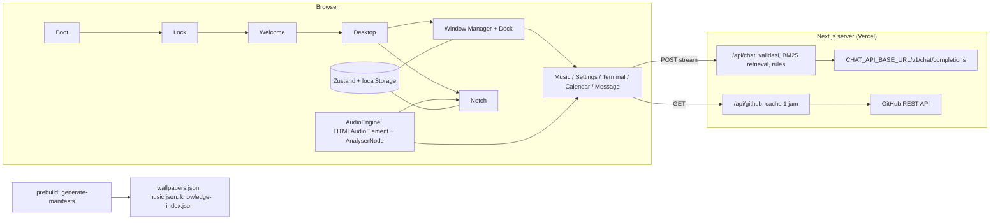
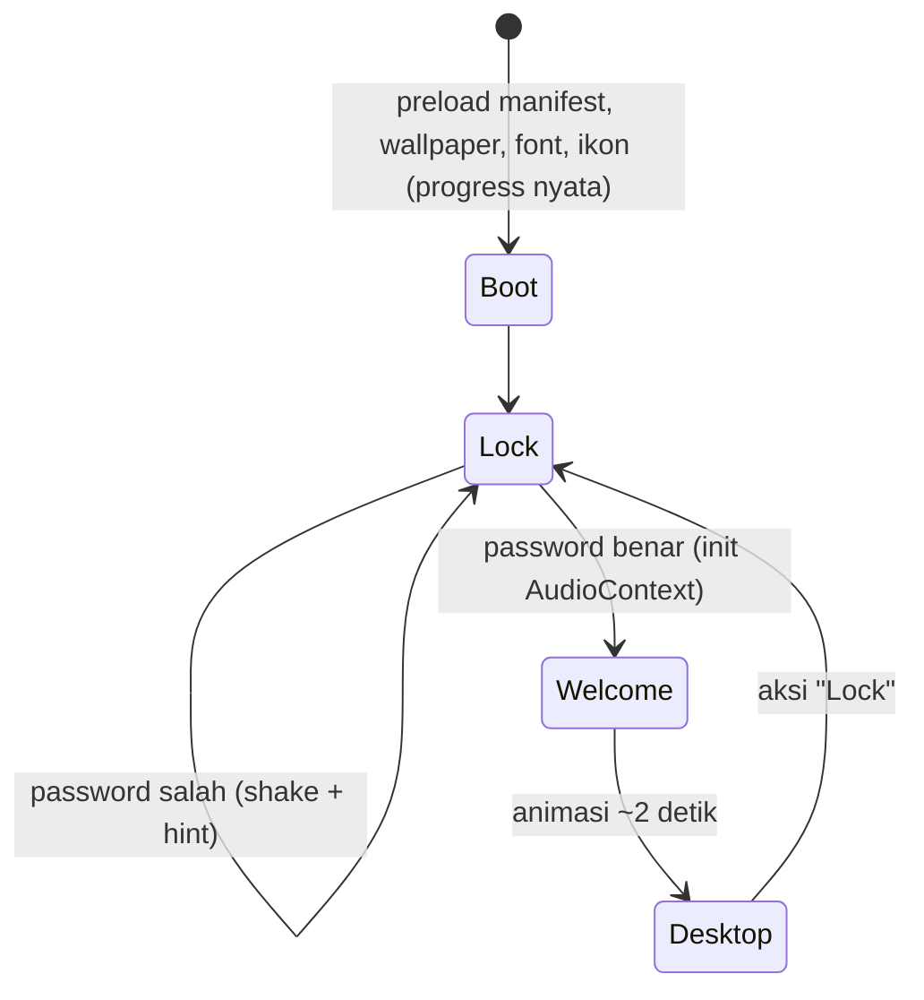

# Rencana Implementasi: sramadhan.cv (Portfolio Bergaya OS)

## Problem Statement

Membangun website portfolio Satria Ramadhan (Software Engineer) di domain sramadhan.cv yang tampil dan berperilaku seperti sistem operasi desktop. Alurnya boot (memuat aset) → lockscreen → welcome → desktop. MVP 1 berisi aplikasi Music, Notch PioPio, Pengaturan, Terminal, Kalender, dan Message (chatbot dengan RAG). Proyek dimulai dari workspace kosong.

Referensi desain: https://nectar.kua8.lol/ dan https://github.com/kua8/Nectar. Referensi notch: https://github.com/Kuroi-RE/piopio (proyek pribadi developer).

## Requirements (hasil diskusi)

- **Stack**: Next.js (App Router) + TypeScript, deploy ke Vercel. Route Handler dipakai hanya sebagai proxy tipis.
- **Chatbot**: endpoint OpenAI-compatible milik developer, dikonfigurasi lewat env `CHAT_API_BASE_URL` + `CHAT_API_KEY` (server-only). Website memanggil `{base}/v1/chat/completions` (POST). Server chatbot tidak termasuk ruang lingkup proyek ini. RAG memakai keyword search (BM25/MiniSearch) atas knowledge base. Rules ada di file konfigurasi.
- **Music**: audio dan `.lrc` disediakan developer di `/public/music`. Desain mengikuti Apple Music, dengan tampilan lirik tersinkron ala Better Lyrics.
- **Notch**: port visual PioPio, disambungkan ke state web OS (now playing, spectrum, lirik, shortcut aplikasi). Ada ring CPU/RAM simulasi (dekoratif) dan baterai dari Battery API jika didukung browser.
- **Bahasa**: bilingual ID/EN dengan toggle di Pengaturan. Konten disimpan sebagai file bertipe di `content/`.
- **Window**: drag, resize, minimize/maximize/close, z-order. Dock punya indikator aplikasi yang berjalan. Posisi window dan settings disimpan di `localStorage`.
- **Lockscreen**: password gimmick dengan hint (bukan keamanan nyata).
- **Wallpaper**: hanya dari developer di `/public/wallpaper`. Daftarnya dibuat otomatis saat build.
- **Pengaturan**: Set Wallpaper, System Accent (8 preset, tema dark saja), Bahasa, About (profil developer).
- **Terminal**: `help` (semua perintah), `about` (info Satria Ramadhan), `github` (link profil + stats via `/api/github`, cache 1 jam, `GITHUB_TOKEN` opsional), `clear` (bersihkan riwayat), `sosial` (link Threads, Instagram, LinkedIn).
- **Kalender**: event project per tanggal. Hover (desktop) atau tap (mobile) menampilkan card berisi thumbnail, nama project, deskripsi, link GitHub, dan link demo. Contoh: 18 September → hover → card project.
- **Mobile**: layout terpisah ala iOS (home screen ikon, aplikasi fullscreen), ditambah banner kecil "Best viewed on desktop".
- **Aset**: placeholder dulu (ikon Lucide, logo teks "SR", foto placeholder), nanti diganti developer di `content/` dan `/public`.
- **Tooling**: Node 24 + npm.

## Background (hasil riset)

- **Nectar**: aplikasi Tauri (Rust + React) dengan notch dan dock beranimasi spring. Lisensinya **GPLv3**, jadi Nectar hanya dipakai sebagai acuan visual dan kodenya tidak disalin. Kalau kodenya disalin, seluruh website wajib ikut GPL.
- **PioPio** (milik developer) memakai React 19 + Vite + TypeScript + Vitest. `src/components/island/` berisi `IslandView`, `geometry.ts`, `LyricsSheet`, `better-lyrics`, `Spectrum` + `spectrum-engine`, `PandaMascot`, `lyrics.ts`, dan `useLyricPulse`. Fungsi murni yang bisa langsung di-port: `currentLineIndex` (binary search dengan lead 200 ms), `lineTiming` (durasi baris, baris terakhir sampai akhir lagu atau 4 detik), dan `useCurrentLyric` (tick 250 ms dari anchor posisi). Bagian yang bergantung pada Tauri (`services/lyrics` yang memakai LRCLIB, sysmon, media session Windows, notifikasi, drag window) diganti dengan adapter web atau tidak dibawa.
- **Batasan browser**:
  - Browser tidak bisa membaca isi folder `/public`, jadi daftar wallpaper dan musik dibuat oleh script `prebuild`/`predev`.
  - Kebijakan autoplay mewajibkan `AudioContext` dibuat setelah ada interaksi pengguna. Momen unlock lockscreen dipakai untuk itu.
  - Battery API tidak ada di Firefox dan Safari, jadi ring baterai disembunyikan di sana.

## Proposed Solution

### Arsitektur



### Alur sistem



Dalam satu sesi (`sessionStorage`), boot berikutnya dipercepat. Kalau `prefers-reduced-motion` aktif, semua animasi disederhanakan.

### Pilihan teknis

| Kebutuhan          | Pilihan                                                                | Alasan                                                                               |
| ------------------ | ---------------------------------------------------------------------- | ------------------------------------------------------------------------------------ |
| Styling            | Tailwind v4 + CSS variables (`--accent`)                               | Accent cukup diganti lewat satu variable. CSS PioPio bisa dibawa sebagai CSS module. |
| Animasi spring     | `motion` (Framer Motion)                                               | Animasi spring seperti Nectar dan PioPio.                                            |
| State              | `zustand` + `persist`                                                  | Window, settings, dan player bisa diakses lintas komponen.                           |
| Window drag/resize | `react-rnd`                                                            | Lebih sedikit kode custom dan risiko bug lebih kecil.                                |
| i18n               | Kamus bertipe + `t()` sendiri, konten `{ id, en }`                     | Website single-page, jadi tidak perlu i18n berbasis routing.                         |
| Validasi           | `zod`                                                                  | Validasi konten saat build dan input API.                                            |
| RAG                | `minisearch` (BM25)                                                    | Tidak butuh endpoint embeddings.                                                     |
| Metadata musik     | `music-metadata` saat build                                            | Membaca tag ID3 (judul, artis, album, durasi, cover) secara otomatis.                |
| Ikon               | `lucide-react`                                                         | Placeholder sampai ikon custom tersedia.                                             |
| Markdown chat      | `react-markdown` + `remark-gfm` (sanitized)                            | Sama seperti PioPio.                                                                 |
| Test               | Vitest + React Testing Library, Playwright (desktop + mobile viewport) | Pola yang sama dengan PioPio.                                                        |

### Struktur folder

```
content/            profile.ts, socials.ts, projects.ts, system.ts (password, hint), i18n/{id,en}.ts
content/chatbot/    rules.md, config.ts (model, temperature, topK, maxContextChars, maxTokens), knowledge/*.md
public/wallpaper/   file gambar dari developer
public/music/       *.mp3 + *.lrc (nama file sama), covers/ (hasil ekstraksi build)
scripts/            generate-manifests.mjs, build-knowledge.mjs
src/app/            layout.tsx, page.tsx, api/chat/route.ts, api/github/route.ts
src/os/             boot/, lock/, welcome/, desktop/, dock/, window-manager/, mobile/
src/apps/           music/, settings/, terminal/, calendar/, message/
src/notch/          port PioPio (island, lyrics, spectrum, panda) + adapters/
src/lib/            audio-engine, lrc-parser, i18n, stores
```

### Env

| Variable            | Wajib | Keterangan                                                      |
| ------------------- | ----- | --------------------------------------------------------------- |
| `CHAT_API_BASE_URL` | Ya    | Base URL endpoint OpenAI-compatible (tanpa `/v1`)               |
| `CHAT_API_KEY`      | Ya    | Server-only, dikirim sebagai `Authorization: Bearer`            |
| `CHAT_MODEL`        | Ya    | Nama model untuk chat completions                               |
| `CHAT_STREAM`       | Tidak | Default `true`; `false` jika endpoint tidak mendukung streaming |
| `GITHUB_TOKEN`      | Tidak | Menaikkan rate limit GitHub API                                 |

Username GitHub disimpan di `content/profile.ts`. File `.env.example` ikut di-commit.

### Keamanan

- Key hanya ada di server, tidak pernah memakai prefix `NEXT_PUBLIC_`.
- Input `/api/chat` dibatasi dengan zod: maksimal 20 pesan, 2.000 karakter per pesan, dan `max_tokens` dikunci di config.
- Rate limit sederhana per IP. Limit ini best-effort di serverless dan bisa diganti Upstash nanti.
- Header CSP dan keamanan dipasang di `next.config`. Semua link eksternal memakai `rel="noopener noreferrer"`.
- Password lockscreen hanya gimmick dan ada di bundle client. Ini disengaja.

## Daftar Task

| #   | Task                                                              | Dependencies |
| --- | ----------------------------------------------------------------- | ------------ |
| 1   | [Scaffold proyek dan pipeline kualitas](./01-task-scaffold.md)    | -            |
| 2   | [Lapisan konten dan i18n](./02-task-content-i18n.md)              | 1            |
| 3   | [Generator manifest aset](./03-task-asset-manifests.md)           | 2            |
| 4   | [Boot → Lock → Welcome → Desktop](./04-task-boot-lock-welcome.md) | 3            |
| 5   | [Window manager dan dock](./05-task-window-manager-dock.md)       | 4            |
| 6   | [Aplikasi Pengaturan](./06-task-settings.md)                      | 5            |
| 7   | [Terminal (perintah lokal)](./07-task-terminal.md)                | 5            |
| 8   | [`/api/github` + perintah `github`](./08-task-github-api.md)      | 7            |
| 9   | [Kalender](./09-task-calendar.md)                                 | 5            |
| 10  | [Audio engine dan aplikasi Music](./10-task-audio-music.md)       | 3, 5         |
| 11  | [Tampilan lirik Better Lyrics](./11-task-better-lyrics.md)        | 10           |
| 12  | [Notch PioPio](./12-task-notch-piopio.md)                         | 11           |
| 13  | [Backend chatbot (RAG dan rules)](./13-task-chatbot-backend.md)   | 2            |
| 14  | [Aplikasi Message](./14-task-message-app.md)                      | 5, 13        |
| 15  | [Layout mobile ala iOS](./15-task-mobile-ios.md)                  | 6–14         |
| 16  | [Polish, SEO, dan deploy](./16-task-polish-deploy.md)             | 15           |
